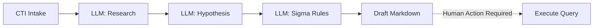
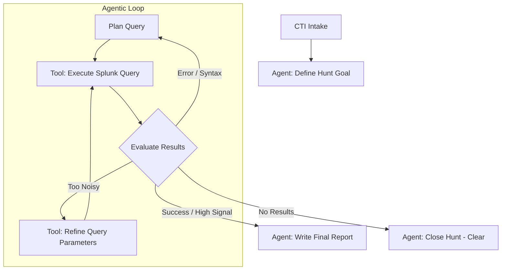

# Transitioning Hecate-Runner to a Fully Agentic Architecture

This document outlines the architectural changes required to transition Hecate-Runner from a **deterministic pipeline** (its current state) to a **fully agentic threat hunting system**.

## 1. Current State vs. Agentic Vision

### Current State: The Linear Pipeline
Currently, `Hecate-Runner` is an orchestration script. It treats LLMs as isolated sub-routines (functions) within a rigidly coded pipeline. 
* **Flow:** Intake CTI ➔ Generate Research ➔ Generate Hypothesis ➔ Generate Sigma ➔ Draft Markdown ➔ **Stop.**
* **Human-in-the-Loop:** A human must manually review the draft, convert the Sigma rules, execute the SIEM query, and write the final report.
* **State:** Maintained via rigid dataclasses (`HypothesisResult`) and file system checkpoints.

### The Vision: Fully Agentic
In a fully agentic architecture, the LLM is not just a text generator; it is the **control loop**. The agent is given a high-level goal ("Determine if this CTI exists in our environment"), a set of tools (SIEM execution, EDR lookup, web search), and the autonomy to plan, execute, evaluate, and iterate until the goal is met.

---

## 2. Implementation Roadmap

To make Hecate-Runner fully agentic, implement the following architectural phases:

### Phase 1: Tool Empowerment & Closing the Loop
The biggest barrier to agency right now is `query_execution.py` explicitly refusing to auto-execute queries.
1. **Expose SIEM as a Tool:** Refactor the Hecate Core LLM system (e.g., using LangChain, AutoGen, or raw function calling) to expose `SplunkQueryProvider.execute()` as an actionable tool.
2. **Implement an Execution Loop:** Instead of generating a draft and stopping, instruct the agent to execute its generated Sigma/Splunk query using the tool.
3. **Feedback Mechanism:** Feed the `QueryResult` (errors, row counts, sample data) back into the agent's context window so it can "see" what happened.

### Phase 2: Self-Correction & Refinement
An agent must be able to recover from failure.
1. **Syntax Recovery:** If the Splunk tool returns a syntax error, the agent must be prompted to read the error and try again.
2. **Noise Reduction:** Set an agentic guardrail. If a query returns 50,000 rows, the agent must autonomously recognize this is too noisy and use a tool to narrow the scope (e.g., excluding common business domains).

### Phase 3: Multi-Agent Architecture
Rather than one monolithic agent trying to do everything, split the runner into a specialized **Agent Team**:
* **The Researcher:** Takes the CTI, uses the web search tool, and builds context.
* **The Hunter (Query Agent):** Takes the research, generates SIEM queries, and iteratively executes them until it finds clean data.
* **The Reviewer / Auditor:** A separate LLM instance that critiques the Hunter's findings against the original CTI to prevent hallucinations.
* **The Reporter:** Takes the confirmed findings and writes the executive summary.

### Phase 4: Expanding the Tool Horizon
To hunt effectively, the agent needs access to the same tools a human SOC analyst uses. Add tools for:
* **Active Directory:** `lookup_user(username)` to add context to a found IP.
* **EDR:** `query_crowdstrike(hash)` to see if a file was actually executed.
* **Threat Intel:** `query_virustotal(ip)` for secondary verification.

---

## 3. Core Challenges & Safety Guardrails

Going fully agentic introduces new risks that the current deterministic pipeline intentionally avoided.

* **Runaway Loops:** Agents can get stuck in infinite loops (e.g., repeatedly trying the same broken query). **Fix:** Implement a hard limit on tool execution iterations (e.g., `MAX_ITERATIONS = 5`).
* **Destructive Actions:** Ensure the tools provided to the agent are strictly **Read-Only**. The agent should be able to query Splunk, but never have a tool that can alter infrastructure or isolate hosts without human approval.
* **Cost:** An agentic loop that makes 15 iterative LLM calls to refine a query will cost significantly more than the current 2-call pipeline. Use smaller, faster models (like Gemini Flash) for the iteration loop, and save the heavy models (Gemini Pro) for final reporting.
* **Hallucinations in Data:** If the agent executes a query and summarizes the results, it might hallucinate findings that aren't there. **Fix:** Require the agent to explicitly cite the raw JSON log `event_id` in its final report.
