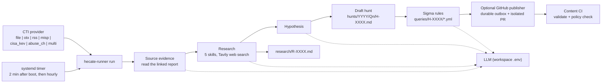

# hecate-runner

Autonomous hunt draft orchestrator for Hecate, whose workspace lives in [Hecate-Core](https://github.com/BrizoSec/Hecate-Core).

**New here?** Start with the [onboarding guide](https://github.com/BrizoSec/Hecate-Core/blob/main/docs/ONBOARDING.md)
for the point of the project and a first run, then [docs/ARCHITECTURE.md](docs/ARCHITECTURE.md)
for the design and its diagrams. This README is the operating reference.

`hecate-runner` sits on top of Hecate and turns it into a persistent, 24/7 hunting loop:

1. Pulls fresh CTI from a configured source (file queue, AlienVault OTX, RSS/Atom feeds, MISP, CISA KEV, or abuse.ch ThreatFox)
2. Reads the report the item links to, researches the technique, and generates a grounded hypothesis, using Hecate-Core's agents and the LLM configured in the workspace
3. Writes a structured draft hunt, with candidate Sigma rules and a grounding audit, into your Hecate workspace
4. Optionally publishes the finished planning bundle as a pull request to Hecate-Content; CI validates it and policy escalations wait for a human approval
5. Never auto-executes queries — a human proposes a bounded query and separately approves running it (see [Query execution](#query-execution-propose-dont-run) below); nothing runs unattended

Runs as a systemd timer on a hunting host, or by hand: `hecate-runner run` takes the next item from the configured feeds, and `hecate-runner draft` takes intelligence you supply. Both go through the same cycle.

## Design principles

- **Core is a library, the workspace is shared.** `hecate-runner` imports `hecate_agent` and calls it in-process; it does not shell out to the `hecate-agent` CLI. Core's optional dependencies must therefore be installed in the Runner's environment, which `uv sync` does from the sibling `../Hecate-Core` checkout.
- **The model proposes, deterministic code disposes.** Every model output is checked by ordinary code before it reaches a draft.
- **Human-in-the-loop by default.** Every generated hunt is `status: planning` with a "review required" banner. Nothing auto-executes.
- **Guardrails first.** Daily draft and research quotas, hard timeouts on LLM calls, structured logs, per-run state persistence.
- **Testable in isolation.** No network and no LLM are needed to run the unit tests locally.

## Architecture



The full cycle, with every branch and outcome, is in [docs/ARCHITECTURE.md](docs/ARCHITECTURE.md).

Research grounding runs before hypothesis generation on every cycle by default (`HECATE_RUNNER_RESEARCH_ENABLED=true`). **A research failure aborts the cycle** (refunds the quota, leaves the CTI queued for retry) rather than falling back to an ungrounded hypothesis: `hecate-agent eval` measured ungrounded generation at ~30% accuracy on known-answer MITRE technique fixtures, so an ungrounded draft isn't a degraded-but-useful fallback, it's an unreliable one. Set `HECATE_RUNNER_RESEARCH_ENABLED=false` to explicitly opt out of research and always generate ungrounded (e.g. for offline testing) — that's a deliberate choice, different from a research call failing mid-cycle.

### Intake triage: park, don't drop

Not everything a feed emits is intelligence. Three of the first fifteen drafts
came from a conference recap, a weekly news roundup, and a vendor post about
agentic SOCs. `HECATE_RUNNER_CTI_TRIAGE=park` (the default) holds those back
before they consume a draft slot.

It parks rather than skips because the two error directions cost very different
amounts. A junk draft costs one review slot and is visible. A wrongly-dropped
item is gone silently — the cursor has already advanced past it. So nothing is
ever discarded: the item is written whole to `<cti_queue>/parked/` with the
reason attached.

```bash
hecate-runner parked list            # what was held back, newest first
hecate-runner parked show <id>       # read one in full
hecate-runner parked restore <id>    # put it back on the queue for the next cycle
```

The rules are deliberately narrow and deterministic rather than clever. A model
was measured on this exact task first: 8/8 on hand-picked examples, but on 36
uncurated live entries it parked 27, including three unambiguous pieces of
intelligence from the highest-signal feed subscribed to, and gave three
different answers to three entries of one monthly series. Recoverability makes
a heuristic gate survivable; it does not make a bad one good. Set
`HECATE_RUNNER_CTI_TRIAGE=off` to draft from everything.

Category and title rules cannot see a commentary post whose category they have
never met (an Elastic product blog tagged "AI & Automation", a Talos opinion
piece tagged "On The Radar"). So there is a second, later gate: when research
reads a prose item and concludes it describes no adversary behavior, the item
is parked there instead of drafted, with the research ID in the reason. The
draft slot is refunded; the research run is not. It uses the same
`HECATE_RUNNER_CTI_TRIAGE` switch.
Parked items are deleted after `HECATE_RUNNER_PARKED_MAX_AGE_DAYS` (default 30;
0 disables).

One exception is automatic: when the CTI is a bare indicator dump with a parseable inventory (a ThreatFox-style feed event), the draft is built deterministically from the indicator list with no LLM call, and research is skipped along with it. There is no behavior described for research to ground, and running it anyway produced documents whose every section said so.

## Grounding

A generated hunt is only worth acting on if its claims trace back to evidence. That is enforced at three points, not one:

**Intake** decides what is worth hunting at all — the galaxy, ATT&CK-technique and org filters above, so a draft starts from a curated event rather than a feed dump.

**Generation** carries the evidence forward. A curated MISP event's indicator *values* reach the model (it previously saw only type counts — "url (9)" — and so wrote hunts that could have been written without reading the CTI). The source's own technique list is merged into the draft rather than replaced by the two or three the hypothesis reasoned about, and sub-technique precision is preserved, since `T1059.003` is Windows-only where bare `T1059` spans five platforms. Research findings citing a CVE that appears in none of the retrieved sources are dropped before they can reach a hunt. Revoked ATT&CK IDs resolve to their replacements instead of vanishing — CTI keeps emitting `T1574.002` years after it was folded into `T1574.001`.

**Audit** re-reads the finished draft and classifies every claim it can check, writing the result into the hunt's own Grounding section:

| Status | Meaning |
|--------|---------|
| `asserted` | The source CTI contains this verbatim — primary evidence |
| `corroborated` | Absent from the CTI, present in the research document. Research is generated, so this is a claim *about* evidence, not evidence |
| `derived` | In no source text but legitimately inferable — a technique the hypothesis reasoned to |
| `unsupported` | Specific, checkable, and absent from every source — the fabrication class, including ATT&CK IDs that do not exist |

**The linked report is read, and only what it says verbatim is kept.** A feed item is usually a short summary: measured across 30 live RSS entries, the summaries contained no IPs, hashes or domains at all. Those live in the linked article. With `HECATE_RUNNER_SOURCE_EVIDENCE_ENABLED=true` (the default) the cycle fetches that one report, has the model extract artifacts from it, and keeps only those whose value and quoted passage appear verbatim in the page. This makes one outbound request to a URL the feed supplied; set the variable to `false` to make none. Without it, or when the fetch fails, an RSS hunt derives its data sources from ATT&CK techniques alone and shows fewer `asserted` claims. That is the source being poorer in checkable facts, not the audit misfiring.

Evidence is ranked because it is not equally trustworthy. Treating a research document as proof lets a fabrication launder itself: a CVE invented during research and written into `R-0611` came back as "asserted" in any hunt built from that research, which is circular. The CTI exists independently of this pipeline; the research does not.

What gets checked: ATT&CK technique IDs (including whether they exist in the current matrix), CVEs, indicators inside generated Sigma rules, and named entities in prose — actor designators like `APT41`, `<Name> backdoor`-style collocations, and CamelCase families like `PureRAT`. Entity checking is precision-first: "adversaries deploy a backdoor" names nothing and is ignored, because a section full of false alarms is one a reviewer learns to skip.

The audit reports rather than blocks, because a hunt that generalises beyond its CTI is doing its job. What it catches is the opposite: an assertion specific enough to *read* as evidence that nothing supports — a fabricated CVE, or a Sigma rule matching a C2 domain no intelligence mentions. Only traceable shapes are examined: a rule matching `\powershell.exe` is behaviour, while one matching `203.0.113.99` is a claim.

## GitHub review and promotion

Publication is disabled unless `HECATE_RUNNER_GITHUB_PUBLISHING_ENABLED=true`
and a narrowly installed GitHub App is configured. Once enabled, Runner
snapshots the completed hunt, its linked research file, Sigma files, and a
digest manifest into a durable SQLite outbox under the ignored `.hecate/`
directory. The GitHub Git API creates a unique branch and pull request without
changing the live workspace checkout. Failed jobs retry with backoff on later
Runner cycles; `hecate-runner publish-sync --status` inspects/retries them
without reading CTI.

The content repo's versioned `promotion-policy.yaml` controls deterministic
escalation. Clean, grounded planning hunts can auto-merge after the two
required checks pass. Missing CTI, a low-confidence source, unsupported claims,
TLP:AMBER, edits to the original bundle, and commits not authored by the App
require a qualified human approval on the latest commit. TLP:RED is blocked.
The publisher refuses a public destination. Every merged hunt remains in
`planning`; promoting it to execution or enabling a production detection still
requires a human.

See the [Hecate-Content promotion setup](https://github.com/BrizoSec/Hecate-Content#github-review-and-promotion)
for App permissions, protected-branch checks, and the `publish` and
`promotion-check` commands.

## Query execution: propose, don't run

Two separate things live here, and the distinction is the whole design: **detection logic is now drafted automatically; execution is still human-initiated and always will be.**

### Sigma drafting (automatic, before review)

After the hypothesis lands, the orchestrator calls Core's Sigma generator and writes one Sigma rule per applicable log source into `$HECATE_WORKSPACE/queries/H-XXXX/`, embedding them in the draft's CHECK section. An operator therefore reviews a hunt that already has candidate detection logic rather than an empty query block.

Sigma rather than SPL or KQL because this program has no committed query platform. `sigma convert -t <backend>` retargets a rule to Splunk, Elastic, CrowdStrike or Defender later, so drafting now commits to nothing — and correspondingly, **a Sigma rule cannot be executed by the propose/approve path below.** It is review material, not a runnable query.

Which log sources are "applicable" is derived deterministically from the hunt's ATT&CK techniques and the indicator types the CTI actually carried, not asked of the model — a backdoor whose event carries nine C2 URLs gets network and DNS rules whether or not the prose mentioned them. The model returns JSON and this code renders the YAML, so a malformed rule is impossible by construction; rules whose `condition` names an undefined selection are rejected rather than emitted, because pySigma would only reject them much later, after the hunt had been reviewed around them.

Generation failing leaves the draft standing with its placeholder query section — the CTI has already been consumed and the quota already spent by that point, so losing the hunt over it would be the wrong trade. Disable with `HECATE_RUNNER_SIGMA_GENERATION_ENABLED=false`.

### Re-auditing hunts already on disk

The grounding audit runs while a hunt is drafted, so a hunt written before a
given version of it was graded by an older one. `hecate-runner audit` re-grades
finished hunts:

```
hecate-runner audit                 # every hunt on disk
hecate-runner audit H-0616          # one
hecate-runner audit --update        # rewrite each hunt's Grounding section
hecate-runner audit --strict        # exit 1 if any claim traces to no source
hecate-runner audit --check-attack  # also validate technique IDs against ATT&CK
```

`--check-attack` is opt-in because it costs one ATT&CK lookup per technique.
A hunt whose CTI cannot be recovered is reported as such rather than scored —
every claim would grade unsupported for want of evidence, which reads like a
fabrication finding and is not one.

### Query execution (human-initiated, unchanged)

A bounded bridge for the query a *human* writes, so running it doesn't mean dropping to a raw SIEM CLI:

```
hecate-runner propose H-0016 --query '...' --data-source splunk \
  --time-range-days 7 --limit 100 --justification '...'
    |
    v   guardrails checked (time range, result limit, non-empty) -- reject outright if violated
.pending_queries/H-0016.json
    |
    v   hecate-runner pending          (see what's staged)
    v   hecate-runner approve H-0016   (re-checks guardrails, prompts to confirm, then executes)
    v   hecate-runner reject H-0016    (discard without running)
    |
    v
QueryProvider.execute()  -->  mock (default) | splunk (shells out to `hecate-agent splunk search`)
```

Guardrails (`HECATE_RUNNER_MAX_QUERY_TIME_RANGE_DAYS`, default 7; `HECATE_RUNNER_MAX_QUERY_LIMIT`, default 1000) mirror Hecate's own `AGENTS.md` Query Guardrails section, and are re-checked at `approve` time, not just at `propose` time — if the staged file was hand-edited or the ceilings changed in between, `approve` refuses rather than trusting the earlier check.

**`HECATE_RUNNER_QUERY_PROVIDER=mock` is the default and, as of this writing, the only backend that's actually been run.** There is no live Splunk instance in this environment to validate `SplunkQueryProvider` against yet — it shells out to `hecate-agent splunk search` (the one place the Runner uses the CLI rather than the library) and is unit-tested against a fake `hecate-agent` binary, but nothing here has touched a real SIEM. Treat it as ready-to-wire, not proven, until it has. Switching from mock to a real backend is meant to be a config change (`HECATE_RUNNER_QUERY_PROVIDER=splunk` + `SPLUNK_HOST`/`SPLUNK_TOKEN` in the Hecate workspace `.env`), not new code — `hecate-runner doctor` checks for both when the provider is set to `splunk`.

## Quickstart (local dev)

```bash
# Clone both repositories side by side: the Runner depends on ../Hecate-Core
git clone https://github.com/BrizoSec/Hecate-Core.git
git clone https://github.com/BrizoSec/Hecate-Runner.git
cd Hecate-Runner

# uv installs Python + venv + deps in one shot
uv sync --dev

# Copy env template and edit
cp .env.example .env
# edit .env to point HECATE_WORKSPACE at wherever your Hecate workspace lives

# Run tests
uv run pytest

# Preview an orchestrator cycle (uses your local Hecate workspace)
uv run hecate-runner run --dry-run

# Real run (researches, generates a hypothesis and writes a draft hunt)
uv run hecate-runner run

# Or draft from intelligence you already have, skipping the feeds
uv run hecate-runner draft --file intel.txt --url https://example.com/the-report
```

## Deploy to k3s-core

```bash
# Push repo
git push origin main

# On k3s-core
cd ~
git clone https://github.com/BrizoSec/Hecate-Runner.git
cd Hecate-Runner

# Install with uv (recommended) or pip
uv sync

# Env
cp .env.example .env
$EDITOR .env

# Install systemd units
sudo ./scripts/install-systemd.sh

# Prime a CTI blurb and force a run
echo "APT actor X observed using T1053.005 scheduled tasks" > $HECATE_WORKSPACE/cti_queue/next.txt
sudo systemctl start hecate-runner-orchestrator.service

# Enable persistent scheduling
sudo systemctl enable --now hecate-runner-orchestrator.timer
sudo systemctl list-timers hecate-runner-orchestrator.timer
```

### Optional: AlienVault OTX CTI provider

Instead of (or alongside) hand-dropping CTI into `cti_queue/next.txt`, `hecate-runner` can pull it from [AlienVault OTX](https://otx.alienvault.com) pulses you're subscribed to.

```bash
# Get a free-tier API key at https://otx.alienvault.com/settings, then:
echo 'OTX_API_KEY=your-key-here' >> .env

# One-off: route the next high-signal pulse into the CTI queue
uv run hecate-runner otx-poll
```

The poller filters for high-signal pulses (TLP white/green, has a MITRE ATT&CK mapping, not older than `HECATE_RUNNER_OTX_MAX_PULSE_AGE_DAYS`) and routes the oldest unrouted one into `cti_queue/next.txt`, so the existing orchestrator picks it up on its normal schedule — OTX polling frequency and hypothesis-generation frequency stay decoupled. A cursor file (`.otx_cursor_state.json` in the Hecate workspace) tracks the last pulse routed so nothing is re-ingested.

You can also skip the file queue entirely and have the orchestrator pull directly from OTX every cycle by setting `HECATE_RUNNER_CTI_PROVIDER=otx`, or by including `otx` in `HECATE_RUNNER_CTI_MULTI_PROVIDERS` under `multi` — which is how this deployment runs, and why there are no poller timers to install.

### RSS/Atom CTI provider (no API key required)

Unlike OTX, this needs no signup or credential — it polls a configured list of security research blog feeds directly.

```bash
# Works out of the box with nine verified defaults (The DFIR Report, Talos,
# Unit42, Microsoft Security Blog, Google TAG, Mandiant, Sekoia, Volexity,
# WeLiveSecurity) -- override with your own list:
# HECATE_RUNNER_RSS_FEED_URLS=https://a.example.com/feed/,https://b.example.com/feed/

# One-off: route the oldest unrouted entry across all configured feeds
uv run hecate-runner rss-poll
```

Unlike OTX's crowdsourced pulse firehose (filtered by TLP + ATT&CK mapping), the "high signal" filter here is mostly the curation itself — every URL in the list is a feed you picked, not an open subscription. Entries are only filtered by age (`HECATE_RUNNER_RSS_MAX_ENTRY_AGE_DAYS`, default 30) and dedup (`.rss_cursor_state.json`, one cursor per feed URL). A MITRE technique ID is still extracted from the title/summary when present and included as metadata, but its absence doesn't exclude an entry.

One feed being down or blocking automated requests doesn't stop entries from the others — CISA's advisory feed was tried while building this and excluded from the defaults for exactly that reason (403s on every path tried, with or without a browser-like User-Agent).

Same dual-mode support as OTX: `HECATE_RUNNER_CTI_PROVIDER=rss` pulls directly from the configured feeds every orchestrator cycle instead of routing through the file queue via a separate `rss-poll` run.

### MISP CTI provider

```bash
# Point at your MISP instance and a dedicated automation key (Administration
# -> List Auth Keys -> Add authentication key in the MISP UI -- not a
# personal user's key):
# MISP_BASE_URL=https://localhost:8443
# MISP_API_KEY=...
# HECATE_RUNNER_MISP_VERIFY_SSL=false   # only for self-signed dev/test instances

# One-off: route the oldest unrouted published event
uv run hecate-runner misp-poll
```

Polls `POST /events/restSearch` for `published` events, incrementally synced via a `timestamp` cursor (`.misp_cursor_state.json`) the same way OTX's `modified_since` works. Pages are fetched metadata-only — attributes are the bulk of the payload and selection doesn't need them — and only the chosen event is re-fetched in full. TLP is tag-based rather than a dedicated field: an explicit `tlp:red`/`tlp:amber` tag excludes an event, while no TLP tag at all defaults to included, matching how `OtxProvider` treats a missing TLP field. ATT&CK technique IDs are read from `GalaxyCluster.meta.external_id` (confirmed against MISP's own bundled galaxy library), with a regex fallback across tag names.

Same dual-mode support as OTX/RSS: `HECATE_RUNNER_CTI_PROVIDER=misp` pulls directly from MISP every orchestrator cycle instead of routing through the file queue via a separate `misp-poll` run.

**Three knobs decide what actually gets routed, and they work together.** `HECATE_RUNNER_MISP_REQUIRE_GALAXY` (default on) skips events carrying no galaxy cluster. Galaxy presence is the cleanest separator between a curated, analyst-written event and a bulk indicator dump — on the reference instance every curated event carried clusters and averaged ~25 attributes, while every ThreatFox event carried none and averaged ~734. `HECATE_RUNNER_MISP_BACKFILL` drops the 30-day freshness floor so the archive can be walked oldest-first, for an instance whose curated events predate that window; seed the cursor file to choose where the walk starts. The cursor advances every poll and converges back into normal freshness-floored behavior once it reaches the present — turn backfill off then, since with it on a lost cursor restarts from the beginning of the archive.

`HECATE_RUNNER_MISP_ORG_ALLOWLIST` covers what galaxy presence cannot. Galaxy separates curated events from dumps, but not a *high-volume curated feed* from the handful of analyst-written events beside it: on the reference instance one org accounts for 856 of 872 routable events, so at any sane `MAX_DRAFTS_PER_DAY` the other 16 sit behind a year of queue. Listing the orgs you actually read surfaces those first. It restricts rather than ranks — skipped events are walked past permanently, since the cursor advances over them — so widen the list before a backfill, or reseed the cursor to revisit what it stepped over.

Used alone each is a trap: requiring galaxies on a dump-heavy recent window starves the poll, and backfilling without the filter simply works through the dumps too.

**Standing up a local MISP instance for dev/test:** see [MISP/misp-docker](https://github.com/MISP/misp-docker) — `docker compose up`, then create a dedicated Auth key as above. On a host already running an ingress controller, bind non-standard ports (e.g. 8080/8443) and set `BASE_URL` to match: Traefik claims 80/443 system-wide via iptables NAT including loopback, which `ss` does not show.

### CISA KEV provider

```bash
# No credential required -- the catalog is a public JSON feed.
HECATE_RUNNER_CTI_PROVIDER=cisa_kev   # or include cisa_kev in CTI_MULTI_PROVIDERS
```

Polls the [CISA Known Exploited Vulnerabilities catalog](https://www.cisa.gov/known-exploited-vulnerabilities-catalog)
and returns entries added since the last cursor date.

This source is vulnerability-shaped, not behavior-shaped, and the drafts read
that way: a hunt for exploitation of one specific CVE rather than for a TTP. That
is the right shape for "is this being used against us", and the wrong one if you
are expecting the behavioral hunts MISP and RSS produce.

### abuse.ch ThreatFox provider

```bash
# Also credential-free.
HECATE_RUNNER_CTI_PROVIDER=abuse_ch   # or include abuse_ch in CTI_MULTI_PROVIDERS
```

Polls ThreatFox's recent-IOC export, cursored on the highest IOC id already seen.

ThreatFox is a bare indicator feed, so it hits the deterministic path described
under Grounding: the draft is built from the indicator inventory with no LLM call
and research is skipped, because there is no described behavior to ground. Expect
indicator-sweep hunts, not hypotheses.

## Configuration

All config comes from environment variables (or a `.env` file in the working directory). See [.env.example](.env.example) for the full list.

**Two `.env` files, different jobs.** This repo's `.env` configures the orchestrator. The Hecate workspace has its own, which `hecate-agent` loads itself — that is where `TAVILY_API_KEY`, `HECATE_LLM_PROVIDER` and `HECATE_LLM_MODEL` belong, so manual `hecate-agent` runs and orchestrated ones use the same model. `hecate-runner` passes only `HECATE_WORKSPACE` and the live call log path (`HECATE_LLM_CALL_LOG`) through by default. No variable appears in both `.env.example` files, so there is never a question of which copy wins — the settings still exist to override `HECATE_LLM_*` from here, but they are deliberately absent from the example, since setting them splits manual and orchestrated runs onto different models.

Key ones:

| Var | Purpose | Default |
|-----|---------|---------|
| `HECATE_WORKSPACE` | Path to the Hecate workspace (Hecate-Core) | `~/betas/Hecate-Core` |
| `HECATE_BIN` | Path to the `hecate-agent` CLI | `<workspace>/.venv/bin/hecate-agent` |
| `HECATE_RUNNER_MAX_DRAFTS_PER_DAY` | Cap on drafts per 24h | `4` |
| `HECATE_RUNNER_MAX_RESEARCH_RUNS_PER_DAY` | Cap on web-searching research runs per UTC day, checked before the source read; not refunded on a failed cycle, so retries can't drain the Tavily quota | `7` |
| `HECATE_RUNNER_LLM_TIMEOUT_SEC` | Hard timeout on any single call into Core (research call and hypothesis call each get their own budget) | `1500` |
| `HECATE_RUNNER_SOURCE_EVIDENCE_ENABLED` | Fetch the report a CTI item links to and keep the artifacts verified verbatim against it, before research and drafting | `true` |
| `HECATE_RUNNER_RESEARCH_ENABLED` | Run web-grounded research before hypothesis generation | `true` |
| `HECATE_RUNNER_RESEARCH_DEPTH` | `basic` (~5 min) or `advanced` (~15-20 min) research depth | `advanced` |
| `HECATE_RUNNER_CTI_PROVIDER` | Which CTI source to use (`file`, `otx`, `rss`, `misp`, `cisa_kev`, `abuse_ch`, or `multi`) | `file` |
| `HECATE_RUNNER_CTI_MULTI_PROVIDERS` | Sub-providers to rotate through when `CTI_PROVIDER=multi` | `rss,otx,misp` |
| `HECATE_RUNNER_CTI_TRIAGE` | `park` holds commentary-shaped CTI in `<cti_queue>/parked/`; `off` drafts from everything | `park` |
| `HECATE_RUNNER_PARKED_MAX_AGE_DAYS` | Delete parked items after this many days (0 disables) | `30` |
| `HECATE_RUNNER_CTI_QUEUE_DIR` | Override the CTI queue location | `<workspace>/cti_queue` |
| `HECATE_RUNNER_LOG_LEVEL` | Orchestrator log level | `INFO` |
| `OTX_API_KEY` | AlienVault OTX API key — required for `cti_provider=otx` and `hecate-runner otx-poll` | — |
| `HECATE_RUNNER_RSS_FEED_URLS` | Comma-separated RSS/Atom feed URLs — no API key needed | 9 verified defaults, see `config.py` |
| `HECATE_RUNNER_RSS_MAX_ENTRY_AGE_DAYS` | Ignore RSS entries older than this | `30` |
| `MISP_BASE_URL` / `MISP_API_KEY` | MISP instance + dedicated automation Auth key — required for `cti_provider=misp` and `hecate-runner misp-poll` | — |
| `HECATE_RUNNER_MISP_VERIFY_SSL` | Set false only for self-signed dev/test MISP instances | `true` |
| `HECATE_RUNNER_MISP_MAX_EVENT_AGE_DAYS` | Freshness floor on MISP events (ignored when `MISP_BACKFILL` is on) | `30` |
| `HECATE_RUNNER_OTX_MAX_PULSE_AGE_DAYS` | Freshness floor on OTX pulses | `30` |
| `HECATE_RUNNER_MISP_REQUIRE_GALAXY` | Only route MISP events carrying a galaxy cluster — keeps bulk indicator dumps (ThreatFox-style) out, since they describe no behavior | `true` |
| `HECATE_RUNNER_LOG_MAX_BYTES` | Rotate the orchestrator log past this size (copy-and-truncate, since systemd co-writes the file) | `5242880` |
| `HECATE_RUNNER_LOG_BACKUP_COUNT` | Rotated logs to keep | `5` |
| `HECATE_RUNNER_SIGMA_GENERATION_ENABLED` | Draft Sigma rules per applicable log source before operator review | `true` |
| `HECATE_RUNNER_SIGMA_TIMEOUT_SEC` | Timeout for Sigma drafting (one LLM call per log source) | `1800` |
| `HECATE_RUNNER_SIGMA_REVIEW_ENABLED` | Review each model-drafted rule against the hypothesis and the verified source passages; costs one model call per rule plus one | `true` |
| `HECATE_RUNNER_MISP_REQUIRE_ATTACK_TECHNIQUE` | Only route MISP events that map to an ATT&CK technique — stricter than the galaxy check, which any cluster satisfies | `false` |
| `HECATE_RUNNER_MISP_ORG_ALLOWLIST` | Comma-separated MISP org names; only these are routable. Empty = every org. Keeps one high-volume feed from burying the rest | _(empty)_ |
| `HECATE_RUNNER_MISP_BACKFILL` | Ignore the freshness floor and walk the MISP archive oldest-first. Reset the cursor file to start from the beginning | `false` |
| `HECATE_RUNNER_MISP_MAX_PAGES_PER_POLL` | How many event pages one poll may walk before giving up (pages are fetched metadata-only) | `25` |
| `HECATE_RUNNER_QUERY_PROVIDER` | Backend for `hecate-runner approve` (`mock` or `splunk`) — see [Query execution](#query-execution-propose-dont-run) | `mock` |
| `HECATE_RUNNER_MAX_QUERY_TIME_RANGE_DAYS` | Hard ceiling on a proposed query's time range | `7` |
| `HECATE_RUNNER_MAX_QUERY_LIMIT` | Hard ceiling on a proposed query's result limit | `1000` |
| `HECATE_RUNNER_SLACK_WEBHOOK_URL` | Slack incoming webhook — posts on every draft creation, no-op if unset | — |

## Operating it

Beyond `run` and the pollers, the CLI covers the things you reach for when a
cycle looks wrong:

```bash
hecate-runner draft      # draft from intelligence you supply (text, --file or stdin), same cycle as `run`
hecate-runner watch      # follow the decision trail of the running cycle, line by line
hecate-runner status     # quota used today, last run, total drafts
hecate-runner metrics    # stage latency and estimated LLM cost, by CTI source
hecate-runner doctor     # sanity-check the deployment; non-zero exit if anything is off
hecate-runner config     # effective settings as JSON, safe to paste into an issue
hecate-runner parked     # list / show / restore CTI held back by triage
hecate-runner sources    # list / enable / disable / reset cursors, editing .env in place
hecate-runner reset      # return the workspace to a blank state for a fresh evaluation
```

For a full-screen view of a running cycle, run `hecate-agent monitor` from the
workspace: the stage in hand, the trail, host load, the queue, and model usage.

`doctor` is the first thing to run after any deployment change: it checks the
workspace path, the `hecate-agent` binary, credentials for whichever providers
are active, and — when `QUERY_PROVIDER=splunk` — that `SPLUNK_HOST`/`SPLUNK_TOKEN`
are set. It cannot detect an API key that is present and valid but out of quota,
since that would mean spending a paid call on every run.

Each orchestrator cycle appends stage timings and available LLM usage to
`logs/stage_metrics.jsonl`. Use `hecate-runner metrics --days 30` to view
per-stage averages and totals grouped by CTI provider; `--source rss` filters
to one provider. Cost is an estimate from Hecate's model pricing table, not a
provider invoice amount. Older Core versions still contribute wall-clock
timings, while token and cost fields remain unavailable.

Those totals are written when a cycle ends. To see model usage while one is
still running, the Runner has Core append every model call to
`logs/llm_calls.jsonl` as it starts and as it returns; the file is emptied at
the start of each cycle and is what the monitor's usage panel reads mid-cycle.

`sources reset` re-ingests from a source by rewinding its cursor. Note that
cursors advance past items the filters skip, so rewinding is also how you revisit
events an org allowlist or galaxy requirement walked past.

## Development

- Python 3.11+
- Managed with [uv](https://docs.astral.sh/uv/)
- Linted with [ruff](https://docs.astral.sh/ruff/), type-checked with [mypy](https://mypy.readthedocs.io/)
- Tested with pytest — run `uv run pytest` for full suite with coverage

### VS Code

Open the folder in VS Code. Recommended extensions live in `.vscode/extensions.json` and will be suggested on first open. Run/debug configs live in `.vscode/launch.json` — pick "Run orchestrator (dry-run)" from the Run panel.

## License

MIT
