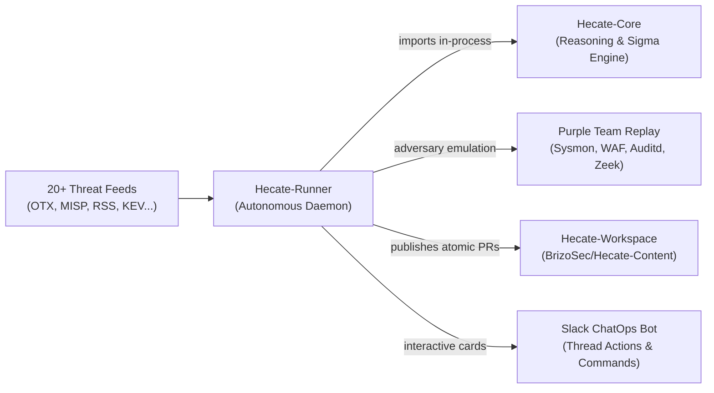

# Hecate-Runner

> **The Autonomous Threat Hunting & Detection Engineering Daemon.**
> Continuous 24/7 CTI intake, dual-track scheduling, adversary emulation, automated rule tuning, and PR publishing.

[](https://www.python.org/downloads/)
[](https://opensource.org/licenses/MIT)
[](systemd/hecate-runner-daemon.service)
[](src/hecate_runner/cti)

---

## 🧭 Overview

**Hecate-Runner** (`hecate_runner`) is the autonomous driver of the Hecate platform. Operating as a perpetual daemon service, it continuously monitors threat intelligence feeds, triages and dedupes incoming advisories, executes purple-team adversary emulation, synthesizes detection logic through [Hecate-Core](https://github.com/BrizoSec/Hecate-Core), and opens pull requests into [Hecate-Workspace](https://github.com/BrizoSec/Hecate-Content).

It enforces strict operational guardrails:
- **Zero-Unattended Production Execution:** Detections are drafted in `status: planning` requiring human approval.
- **Dual-Track Scheduling:** High-velocity indicator feeds use fast deterministic sweeps; narrative reports receive deep agentic research.
- **Automated Self-Remediation:** Detection rules failing syntax, logsource, or platform tests are automatically remediated before saving.
- **Durable Outbox:** Atomic writes and SQLite outboxes guarantee no duplicate drafts or leaked quotas across system reboots.

---

## 🏛 Ecosystem Architecture



- **[Hecate-Core](https://github.com/BrizoSec/Hecate-Core)**: Sibling library providing the LLM agents, ATT&CK STIX matrix, Sigma drafting, and pySigma transpilers.
- **[Hecate-Runner](https://github.com/BrizoSec/Hecate-Runner)** *(this repo)*: Autonomous perpetual daemon, multi-feed CTI triage, purple-team emulation, and Slack bot.
- **[Hecate-Workspace](https://github.com/BrizoSec/Hecate-Content)**: Version-controlled detection repository holding hunts (`hunts/`), queries (`queries/`), research dossiers (`research/`), and promotion gates.

---

## 📂 File & Directory Structure

```text
Hecate-Runner/
├── src/hecate_runner/           # Primary Python package
│   ├── cti/                     # 20+ CTI feed providers (OTX, MISP, RSS, KEV, AnyRun...)
│   ├── orchestrator.py          # Central autonomous worker loop & queue manager
│   ├── purple_team.py           # Adversary emulation & synthetic telemetry replay
│   ├── rule_tuner.py            # Automated reviewer self-remediation feedback loop
│   ├── indicator_sweep.py       # Zero-token deterministic sweep engine
│   ├── github_publisher.py      # Durable SQLite outbox & GitHub PR publisher
│   ├── slack_bot.py             # Interactive Slack Bot with Block Kit UI
│   ├── hunt_writer.py           # Atomic LOCK markdown and Sigma YAML writer
│   ├── config.py                # Environment and quota configuration
│   └── cli.py                   # Typer CLI entrypoint (`hecate-runner`)
├── systemd/                     # Systemd service unit files
│   ├── hecate-runner-daemon.service    # Resident event-driven worker daemon
│   └── hecate-runner-slack-bot.service  # Interactive Slack bot service
├── docs/                        # Complete technical documentation
│   ├── ARCHITECTURE.md          # 3-repo architecture blueprint & data flow
│   ├── FEATURES.md              # Exhaustive feature matrix and subsystem details
│   ├── CHALLENGES.md            # Technical challenges solved (hallucinations, token quotas)
│   └── HOW_TO.md                # Developer recipes & step-by-step guides
├── scripts/                     # Operational scripts (systemd installer)
└── tests/                       # 850+ unit and integration tests
```

---

## 🚀 Quick Start

### 1. Installation

Clone alongside its sibling repositories and install with [uv](https://docs.astral.sh/uv/):

```bash
git clone https://github.com/BrizoSec/Hecate-Runner.git
cd Hecate-Runner

# Install dependencies (automatically links sibling ../Hecate-Core in-process)
uv sync --all-extras
```

### 2. Environment Configuration

Runner symlinks `.env` to `../Hecate-Workspace/.env`. Ensure your configuration includes:

```dotenv
# Threat Intelligence Feeds
OTX_API_KEY=...
MISP_URL=https://misp.example.com
MISP_API_KEY=...

# Model & Search API
HECATE_AI_PROVIDER=anthropic      # or openai, bedrock, ollama
ANTHROPIC_API_KEY=sk-ant-...
TAVILY_API_KEY=tvly-...

# Autonomous Scheduler & Quotas
HECATE_RUNNER_SOURCES=multi       # polls all configured feeds
HECATE_RUNNER_MAX_DRAFTS_PER_DAY=12
HECATE_RUNNER_SWEEP_COOLDOWN_SECONDS=30
HECATE_RUNNER_DEEP_COOLDOWN_SECONDS=180

# GitHub Publishing (Optional PR integration)
HECATE_RUNNER_GITHUB_PUBLISHING_ENABLED=true
HECATE_RUNNER_GITHUB_APP_ID=...
HECATE_RUNNER_GITHUB_INSTALLATION_ID=...
HECATE_RUNNER_GITHUB_APP_PRIVATE_KEY_PATH=/run/secrets/hecate-publisher.pem
HECATE_RUNNER_GITHUB_PUBLISHING_REPOSITORY=BrizoSec/Hecate-Content
```

---

## ⚙️ Operating the Autonomous Daemon

### Running via Systemd (Recommended for Production)

Hecate-Runner includes a production-grade systemd service unit:

```bash
# Install user systemd service
./scripts/install-systemd.sh

# Start daemon
systemctl --user start hecate-runner-daemon.service

# Inspect live status
systemctl --user status hecate-runner-daemon.service

# View streaming journal logs
journalctl --user -u hecate-runner-daemon.service -f
```

### Running Interactively in Foreground
For local development, testing, or debugging:

```bash
# Run daemon continuously with a 60-second polling interval
uv run hecate-runner daemon --interval 60

# Run a single cycle against active feeds
uv run hecate-runner run

# Run a single cycle against a specific feed
uv run hecate-runner run --source cisa_kev
uv run hecate-runner run --source otx
```

### On-Demand Manual Drafting
Draft a hunt immediately from custom threat intelligence text:

```bash
uv run hecate-runner draft \
  --title "Akira Ransomware PerfLogs Staging" \
  --content "Adversaries deployed gost tunnel and rclone into C:\PerfLogs\ to exfiltrate data..." \
  --source-url "https://news.sophos.com/akira-perflogs"
```

---

## 💬 ChatOps & Slack Bot

Launch the interactive Slack Bot to receive real-time notifications with interactive review actions:

```bash
# Run Slack Bot
uv run hecate-runner slack-bot
```

- **Interactive Cards:** Every drafted hunt sends a Block Kit card with title, hypothesis summary, ATT&CK techniques, and candidate Sigma rules.
- **One-Click Actions:** Security engineers can trigger validation replays or request AI rule tuning directly from Slack threads.
- **Slash Commands:** Use `/hecate status`, `/hecate hunt <ID>`, or `/hecate promote <ID>`.

---

## 🧪 Testing & Verification

The entire 850+ test suite runs offline with complete mocks:

```bash
# Run full test suite
uv run pytest -q

# Run specific subsystem tests
uv run pytest tests/test_purple_team_pipeline.py
uv run pytest tests/test_cti_multi.py
uv run pytest tests/test_daemon.py
```

---

## 📚 Complete Documentation

- **[System Architecture](docs/ARCHITECTURE.md)**: Three-repository design, lifecycle diagrams, and agent graphs.
- **[Feature Reference](docs/FEATURES.md)**: Exhaustive breakdown of ingestion, dual-track scheduling, and evaluation.
- **[Engineering Challenges](docs/CHALLENGES.md)**: Deep dive into hallucination defense, token economics, and telemetry synthesis.
- **[Developer How-To Guides](docs/HOW_TO.md)**: Step-by-step recipes for adding CTI feeds, SIEM targets, and local evals.

---

## 📄 License

MIT License. See [LICENSE](LICENSE) for details.
