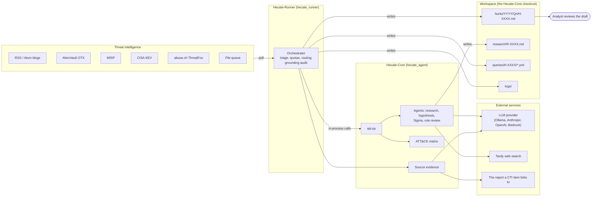
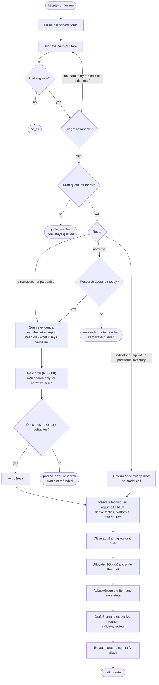
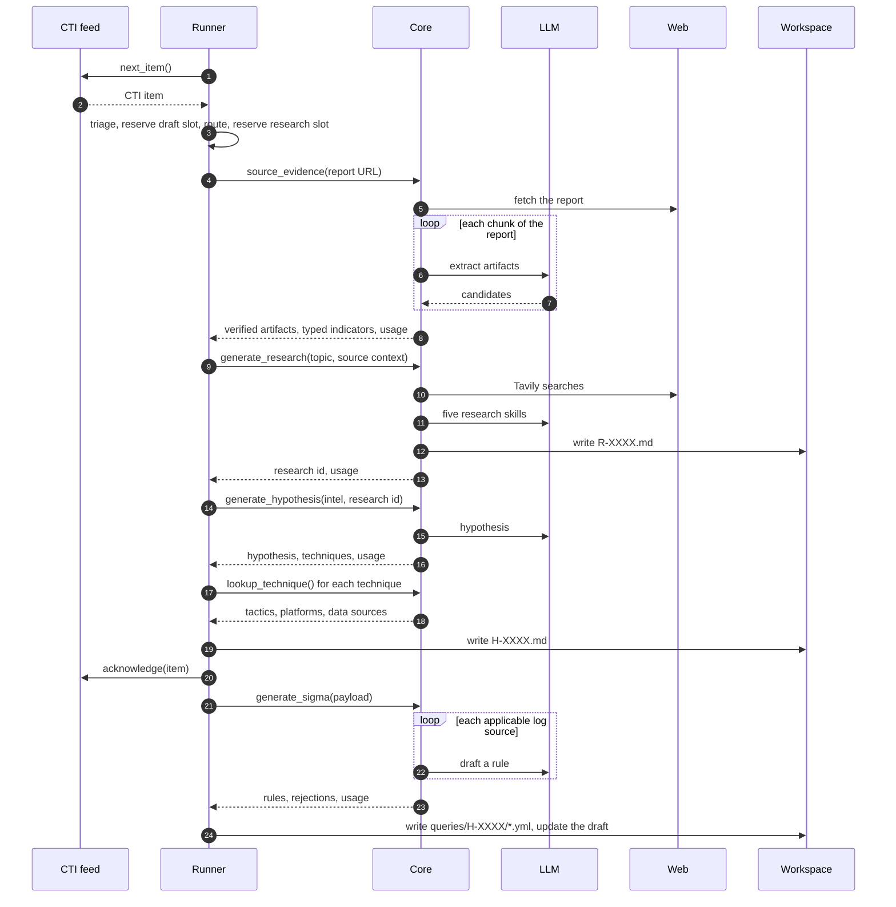
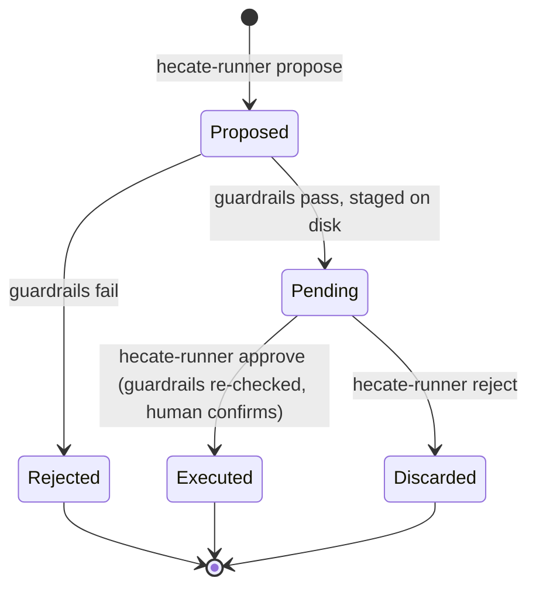
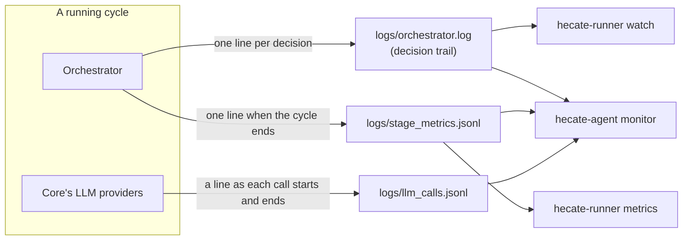

# Hecate: how it all works

How the two repositories fit together, what one orchestrator cycle does, where
the model is allowed to decide things, and how to see what a running cycle is
doing.

New to the project? Read the
[onboarding guide](https://github.com/BrizoSec/Hecate-Core/blob/main/docs/ONBOARDING.md)
first; it explains the point and gets you to a first run. This document is the
design reference behind it.

Last revised 2026-10-05.

---

## The two repositories

**Hecate-Core** (`hecate_agent`) is the agent library, the `hecate-agent` CLI
and the workspace. It owns the LLM agents, the ATT&CK matrix, the hunt document
format, Sigma generation and the research corpus. It knows nothing about
scheduling or intelligence feeds.

**Hecate-Runner** (`hecate_runner`) is the autonomous driver. It polls threat
intelligence, decides what is worth hunting, calls into Core, writes drafts and
enforces quotas and guardrails.

They are siblings on disk, and the Runner depends on Core as an editable path
dependency with all extras: `hecate-agent[all]`.

**One thing to understand before anything else.** The Runner calls Core
**in-process**, importing `hecate_agent.api` directly. It does not shell out to
the `hecate-agent` CLI, even though `HECATE_BIN` still points at it. This means
Core's optional capabilities (ATT&CK STIX data, scikit-learn, Tavily, pySigma)
must be installed in the *Runner's* environment. Installing them in Core's
virtualenv has no effect on what the pipeline can do.

---

## Intake: choosing what to hunt

Six providers implement one interface (`next_item`, `acknowledge`): `rss`,
`otx`, `misp`, `cisa_kev`, `abuse_ch` and `file`. `multi` composes any subset
of them behind the same interface, so the orchestrator never knows it is
talking to more than one source. `hecate-runner sources` manages the set.

**Round-robin, persisted.** `MultiProvider` keeps a cursor so a high-volume
source (ten RSS feeds) cannot crowd out a slow one (a MISP instance with few
new events). The rotation decides tie-break order only; a source is skipped in
a cycle only if it genuinely has nothing new.

The rotation advances on **acknowledge**, not on pick. Every sub-provider
already moves its own cursor that way, and it means an unacknowledged item (a
dry run, or a cycle that dies mid-draft) is re-offered from the same source
rather than silently consuming a slot.

**Triage parks rather than discards.** `cti_triage.triage()` parks conference
announcements, vendor commentary and similar non-actionable items into
`cti_queue/parked/` with a reason attached. `hecate-runner parked` lists them
and `parked restore` puts one back. Nothing is ever thrown away.

Provider evidence profiles add a source-quality gate. MalwareBazaar sample
records with hashes route to deterministic IOC sweeps; family labels and file
types do not count as observed behavior. The Runner skips fetching and
secondary enrichment for these sample records. VX-Underground archive metadata
with no extracted runtime activity is parked for a richer source. These
provider limits apply even when commentary triage is disabled.

**Starting from intelligence in hand.** `hecate-runner draft` takes text an
operator supplies (an argument, a file or standard input, with an optional
report URL) in place of a feed item. It is a different way in, not a different
pipeline: the item goes through the cycle below unchanged, with triage skipped
because someone chose it, and it counts against the same quotas. Core also has
an older LangGraph graph behind `hecate-agent orchestrate`; that one is
experimental, lacks most of the stages below and is not scored against the
gold cases.

**The source-evidence gate.** Provider-declared profiles take precedence over
the prose shape of a generated blurb. Other items use `has_narrative()` to
distinguish a report from a bare indicator dump: a human-written summary or
description, or an explicit ATT&CK technique list. Together these decide the
route the cycle takes.

---

## One orchestrator cycle

`hecate-runner run` executes exactly one cycle. It never raises; it always
returns a `RunResult` with an outcome.

1. **Prune parked items** older than the configured age.
2. **Pick the next actionable item.** Skipped items are acknowledged so the
   cursor moves past them. Walking past an item is not a draft and does not
   cost quota.
3. **Reserve a draft slot.** `max_drafts_per_day` is checked and reserved
   *before* any model call. Exceeding it leaves the intelligence queued for the
   next cycle.
4. **Choose the route** from provider evidence profile and narrative gate.
   - *Sample metadata with routable hashes*: a deterministic IOC sweep; no
     behavioral techniques are inferred from malware family or file type.
   - *Archive metadata without runtime behavior or endpoint indicators*:
     park with a reason before reserving a draft slot.
   - *No narrative but a parseable indicator inventory*: a deterministic
     **sweep hypothesis**, built from the indicators alone without research or
     hypothesis-generation calls. Optional Sigma generation can still run
     afterward; the behavior hypothesis remains limited to indicator presence.
   - *Narrative*: research with web search, then a hypothesis.
   - *No narrative and no parseable inventory*: research without web search,
     then an indicator-only hypothesis.
5. **Reserve a research slot** when the route will search the web.
   `max_research_runs_per_day` is checked here, before anything expensive
   runs. A refused cycle refunds its draft slot and leaves the item queued. A
   research slot is *not* refunded when a later step fails, so retries cannot
   drain the search quota.
6. **Gather source evidence** (`source_evidence`) for report-backed items. The
   feed item is usually a short summary of a much longer report. This step fetches the report the
   item links to, asks the model to extract artifacts from it chunk by chunk,
   and keeps only those whose value and quoted passage appear verbatim in the
   page. It then types the feed's own indicators by role (C2, payload host,
   victim-side target) and status (active or historical). It never fails the
   cycle: without a link, or on a fetch or model failure, the draft proceeds
   from the feed text.
7. **Research** (`generate_research`), unless disabled. Produces `R-XXXX.md`
   as context for the hypothesis that follows; generated research is not
   source evidence for this specific item. A research failure aborts the
   cycle rather than falling back to an ungrounded hypothesis. If research
   concludes a prose item describes no adversary behaviour, the item is parked
   and the draft slot refunded.
8. **Hypothesis generation** (`generate_hypothesis`), constrained by the
   source profile and whether narrative was present. The output includes
   claim excerpts and exact source quotes, checked against the final fields
   and primary CTI text. An empty hypothesis refunds the quota and leaves the
   intelligence queued.
9. **Resolve techniques against the live ATT&CK matrix.** Tactics, platforms
   and data sources are derived deterministically from the resolved techniques,
   merged with what the source asserted. Technique IDs that do not resolve are
   dropped so they cannot reach the frontmatter.
10. **Audit claims and grounding**, then **allocate a hunt ID and write the
    draft** under a lock. The ID is burned at allocation, so a crash leaves a
    gap rather than a collision.
11. **Acknowledge the item and save state.** This happens as soon as the draft
    is on disk and *before* rule generation, so a process killed during the
    slowest step cannot lose the quota count or re-draft the same item.
12. **Generate Sigma rules** (`generate_sigma`), one per applicable log source,
    validate them, and have the rule reviewer check each model-drafted rule
    against the hypothesis and the verified source passages.
13. **Re-audit grounding** with the rules included, render the section and
    notify Slack.

### Who talks to whom

The same cycle as a conversation, for the narrative route:

---

## Where the model decides, and where it does not

This is the heart of the design: **the model proposes, deterministic code
disposes.**

| Decision | Made by |
|---|---|
| Which source to poll | Round-robin cursor |
| Whether an item is actionable | Triage rules and the narrative gate |
| Whether a cycle may spend a draft or a search | Daily quotas |
| Which artifacts from a report count as evidence | Verbatim match against the fetched page |
| Applicable log sources | Technique→logsource map |
| Data sources / telemetry | Technique and indicator maps, then platform-filtered |
| Tactics and platforms | Live ATT&CK matrix lookup |
| Hunt ID and file location | Counter under a lock |
| **Candidate artifacts in a report** | **LLM**, then verified |
| **The hypothesis** | **LLM** |
| **Research prose** | **LLM** |
| **Sigma detection logic** | **LLM**, then validated and reviewed |
| Whether a rule survives | Validators, then pySigma |
| Grounding classification | Regex extraction and source matching |

Every model output passes through a deterministic check before it reaches a
draft. A generated Sigma rule is rejected if it matches on scaffolding values,
reproduces a supplied indicator only as a fragment, excludes the hypothesis's
own attack path, or puts a hostname in an address field. Empty filter blocks
are repaired rather than rejected. Rejected rules are immediately fed back into a
retry loop where the model is prompted with the specific validation failure or
`RuleReviewer` critique so it can self-correct, dramatically reducing empty
query sections. Furthermore, structured IOCs extracted directly from the CTI are
routed to dedicated indicator rules, ensuring high-fidelity extraction without TTP conflation.

---

## The research agent: five skills

`HuntResearcherAgent` runs five skills in sequence:

1. **System research**: how the targeted technology works. Web search.
2. **Adversary tradecraft**: how it is abused. Web search.
3. **Telemetry mapping**: what data sources would show it.
4. **Related work**: similar past hunts, via TF-IDF similarity over the
   existing corpus.
5. **Synthesis**: assembles the research document.

Skills 1 and 2 call Tavily when the narrative gate allowed web search. Skill 4
needs scikit-learn. Both degrade rather than fail, and both say so in the log
when they do, because a silent degradation here produces a document that looks
finished and is not.

---

## The hunt document

Drafts follow the LEARN / OBSERVE / CHECK / KEEP structure, land in
`hunts/YYYY/Qn/H-XXXX.md`, and always start at `status: planning` with a
banner telling the reader not to execute anything yet.

Each draft carries a **grounding audit**: checkable claims (techniques, CVEs,
indicators, actor names) are compared with the embedded CTI and linked primary
report. Generated research and OSINT enrichment do not count as evidence.
Claim Evidence References list the quoted passage and whether it occurs in the
source text; quote presence does not prove semantic support. Unsupported
claims remain visible for review. `hecate-runner audit` re-grades drafts on
disk at any time.

---

## The query loop: human in the loop by design

Drafting a hunt never runs a query. Execution is a separate, deliberately
gated flow:

`validate_guardrails` rejects a query outright for an empty query body, a
non-positive or over-long time range (7 days by default), a non-positive or
over-large row limit, or a missing data source. A query that passes is *staged*,
not run. `hecate-runner approve` is a separate human action.

`query_provider=mock` is the default, so approval cannot touch a real system
until a Splunk backend is configured.

---

## What is on disk

Everything the pipeline produces or remembers lives in the workspace, which is
the Hecate-Core checkout unless `HECATE_WORKSPACE` says otherwise.

| Path | What it holds | Written by |
|---|---|---|
| `hunts/YYYY/Qn/H-XXXX.md` | Draft hunts, in LOCK format | Runner |
| `research/R-XXXX.md` | Background research context linked to a hunt | Core |
| `queries/H-XXXX/*.yml` | Drafted Sigma rules for a hunt | Runner |
| `cti_queue/` | File-queue intake, `parked/` and `processed/` items | Runner |
| `.orchestrator_state.json` | Today's draft and research counts, last run | Runner |
| `.*_cursor_state.json` | How far each feed has been read | Runner |
| `.pending_queries/` | Queries staged for approval | Runner |
| `logs/orchestrator.log` | Every log line, including the decision trail | Runner |
| `logs/stage_metrics.jsonl` | One line per finished cycle: stage timings and model usage | Runner |
| `logs/llm_calls.jsonl` | The running cycle's model calls, as they start and end | Core |

---

## Watching a cycle

A cycle can run for twenty minutes, most of it inside model calls that say
nothing. Three records exist so that a long silence is never the only signal.

**The decision trail.** Each cycle gets a short ID and logs one line per
decision: what it picked, why it routed it the way it did, what each stage
found. Most stages log once, when they finish. The slow ones (source evidence,
research, hypothesis, rule generation) also log a line when they start, so the
trail shows what is in hand. `hecate-runner watch` follows it.

**Stage metrics.** When a cycle ends, one JSON line records every stage's wall
time and the model usage Core reported for it: calls, tokens, estimated cost,
models. `hecate-runner metrics` aggregates these by CTI source.

**The live call log.** Stage metrics arrive only when a cycle ends. So the
Runner passes `HECATE_LLM_CALL_LOG` to Core, and every provider call appends a
line when it is sent and another when it returns or fails. The Runner empties
the file at the start of each cycle, so it only ever holds the cycle in
progress. Outside the Runner the variable is unset and nothing is written.

**The monitor.** `hecate-agent monitor` is a terminal dashboard over all three:
the stage in hand, the trail, host load, the queue, and model usage. While a
cycle runs its usage panel reads the live call log (calls done, calls in
flight, tokens so far); once the cycle ends it shows the recorded per-stage
totals.

---

## Scheduling and safety rails

A systemd timer (`hecate-runner-orchestrator.timer`) starts a cycle two
minutes after boot, then one hour after each activation.

Five independent limits bound autonomous behaviour:

- **Daily draft quota**, reserved before any model call and refunded on failure.
- **Daily research quota**, checked before the source read and not refunded,
  so a failing item cannot drain the web search allowance.
- **Skip limit** of 5 per cycle, so a run cannot spin forever walking past
  items that have nothing to hunt.
- **Consecutive failure tracking** in the orchestrator state.
- **Query guardrails**, which apply regardless of who proposes the query.

Run `hecate-runner doctor` before trusting a deployment. It verifies paths,
credentials, and, importantly, that the optional capabilities are importable
*in the Runner's interpreter* and that ATT&CK STIX data is actually present. A
credential without its client library is a failed check, because that
combination is precisely how grounding sat silently switched off.
